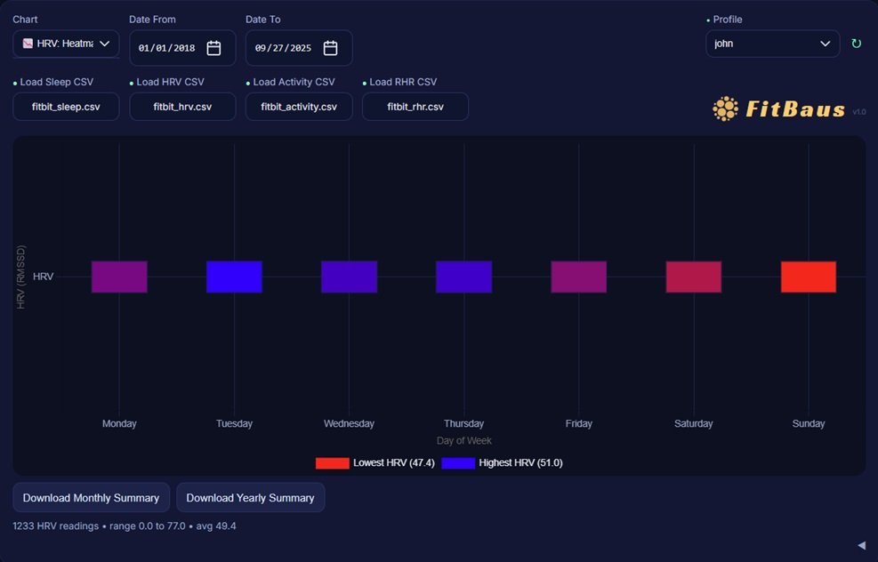
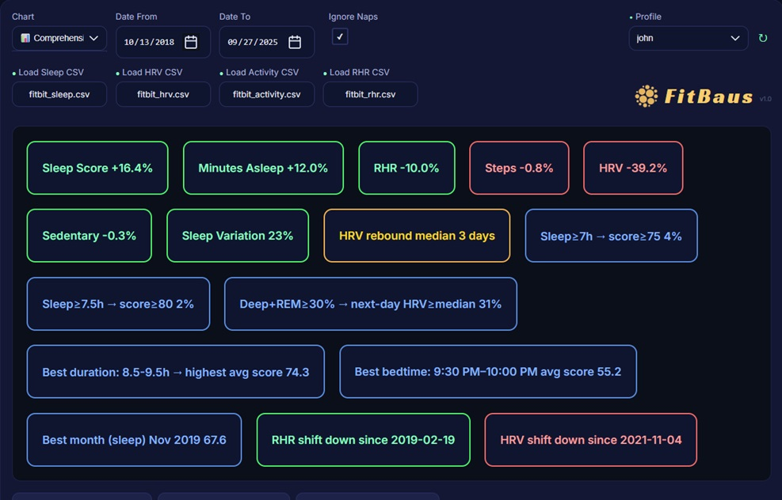
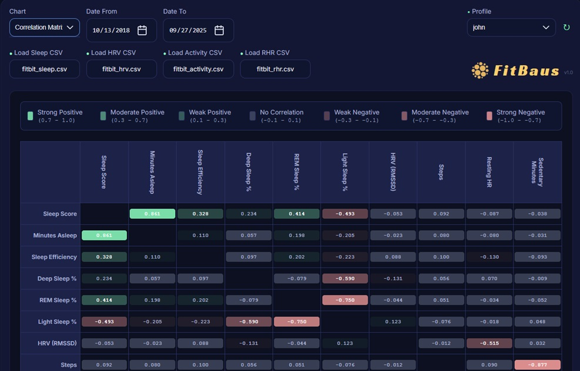
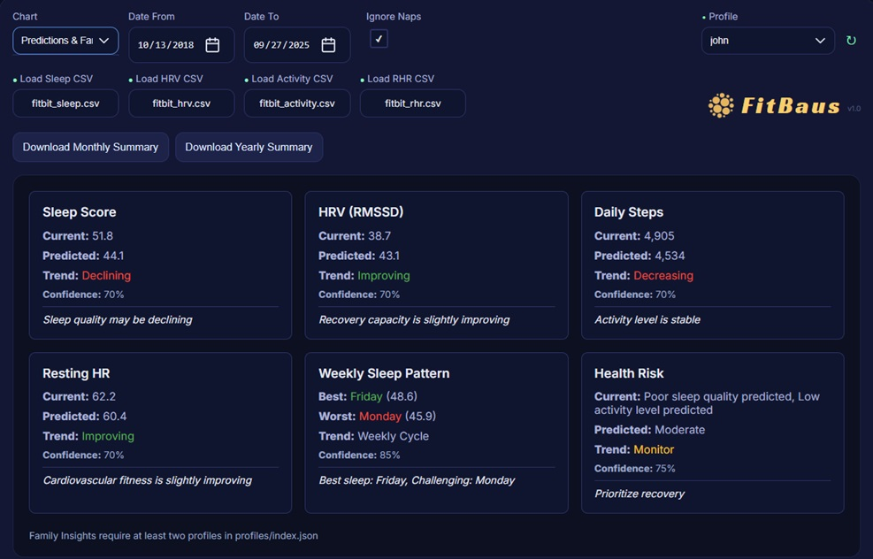
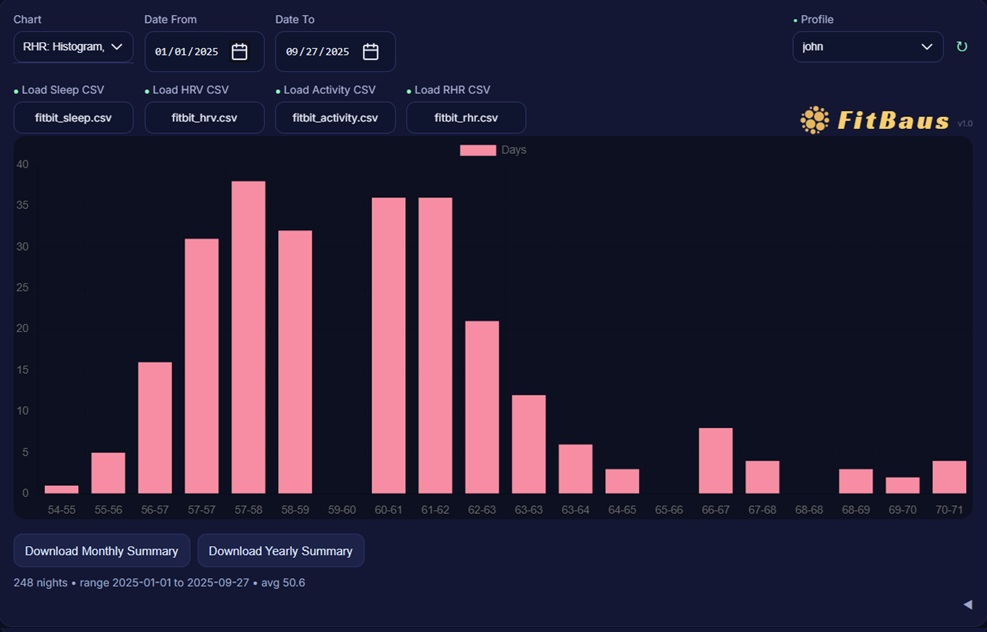
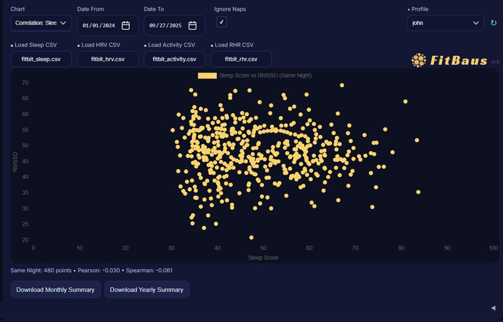

## a data analytics dashboard for Google Health and Fitbit history

FitBaus is web-based dashboard for analyzing your Fitbit health and fitness data with beautiful visualizations, trend analysis, and comprehensive analytics. This project is not affiliated with Fitbit® or Google®


|  |  |  |
|---------|---------|---------|
|  |  |  |

## 🚀 Features

- **Multiple Data Views**: Steps, Sleep Score, Minutes Asleep, Heart Rate Variability (HRV), Resting Heart Rate (RHR)
- **Interactive Charts**: Line charts, bar charts, histograms, and scatter plots
- **Time Period Analysis**: Daily, Monthly, and Yearly views
- **Advanced Analytics**: Comprehensive analytics with correlation analysis
- **Data Export**: Download charts and data as CSV files
- **Multi-Profile Support**: Manage multiple Abit accounts
- **Beautiful UI**: Modern, responsive design with dark theme

## Public API

FitBaus now exposes a versioned public read-only API for other projects.

- Human docs: [`API.md`](API.md)
- Browser docs: `/api/public/v1/docs`
- OpenAPI JSON: `/api/public/v1/openapi.json`

Key endpoints:

- `/api/public/v1/profiles`
- `/api/public/v1/profiles/<profile_id>/dashboard`
- `/api/public/v1/profiles/<profile_id>/datasets/<dataset>`
- `/api/public/v1/profiles/<profile_id>/series/<granularity>`
- `/api/public/v1/profiles/<profile_id>/charts/overview-trend.svg`

## Google Health API v4 setup

New connections use Google OAuth and Google Health API v4. Existing Fitbit connections remain active until that profile completes Google authorization; historical CSVs are retained. Legacy Fitbit tokens cannot be reused with Google Health.

1. Follow [Google Cloud setup](https://developers.google.com/health/setup): create a project, enable Google Health API, configure an external OAuth consent screen, and add your own Google account as a test user.
2. Create a **Web application** OAuth client and register `http://localhost:8080/callback` as an authorized redirect URI. FitBaus accepts a manually pasted full redirect URL, so localhost does not need to serve a page.
3. Enable the read-only scopes listed in [GOOGLE_HEALTH.md](GOOGLE_HEALTH.md). Save the Google Client ID and Client Secret privately.
4. Start FitBaus with `docker compose up -d --build`. Configure the existing administrator password and production HTTPS reverse proxy as described in [DEPLOYMENT.md](DEPLOYMENT.md).
5. Open the dashboard → administrator login → **档案管理**. For an existing profile select **连接 Google Health** and enter the Google client configuration; for a new profile fill in the new-profile form.
6. Open Google consent, using the Google account linked to your original Fitbit data, then paste the **entire final callback URL including `code` and `state`** into FitBaus. First sign into the Google Health mobile app if the account is not linked yet.
7. Select **同步健康数据**. Manual and scheduled syncs now use Google Health for this profile.

The app validates identity before changing providers, disables legacy fetching for migrated profiles, and revokes the legacy Fitbit token. If linking fails, the previous connection and historical data remain intact. Missing permissions are reported; only permitted datasets are updated.

For headless use:

```bash
python auth/authorize_google_health.py --profile myprofile
python fetch/fetch_all.py --profile myprofile
```

Google client configuration can also be supplied using `GOOGLE_HEALTH_CLIENT_ID`, `GOOGLE_HEALTH_CLIENT_SECRET`, and optional `GOOGLE_HEALTH_REDIRECT_URI`. Per-profile credentials are saved separately in `profiles/<id>/auth/google_client.json`; the old `client.json` is reserved for legacy Fitbit.

See [GOOGLE_HEALTH.md](GOOGLE_HEALTH.md) for migration details, supported data, and troubleshooting. CSV filenames retain the `fitbit_` prefix so the public read API and existing charts stay compatible.

## 📊 Dashboard Features

### Chart Types

1. **Steps**: Daily step counts with histogram analysis
2. **Sleep Score**: Sleep quality scores with distribution analysis
3. **Minutes Asleep**: Sleep duration tracking
4. **HRV**: Heart Rate Variability analysis
5. **RHR**: Resting Heart Rate trends
6. **Comprehensive Analytics**: Advanced correlation and trend analysis
7. **Predictions & Family Insights**: AI-powered health predictions and family wellness analysis
8. **Life Events**: Personal event tracking with health correlation analysis

### View Options

- **Daily View**: Shows individual day data points
- **Monthly View**: Aggregated monthly averages
- **Yearly View**: Year-over-year comparisons

### Interactive Features

- **Date Range Selection**: Filter data by custom date ranges
- **Data Previews**: Expandable tables showing raw data
- **Export Options**: Download charts and data as CSV files
- **Trend Analysis**: Linear regression trend lines
- **Histogram Analysis**: Distribution analysis for steps and sleep scores
- **Profile Selection**: Dropdown to switch between different user profiles
- **Sleep Histogram Download**: Export sleep score distribution data as CSV
- **Comprehensive Analytics**: Advanced correlation analysis with downloadable summary
- **Predictions & Family Insights**: AI-powered health predictions with confidence scores and family wellness analysis
- **Life Events Tracking**: Personal event logging with sentiment analysis and health correlation

### Advanced Features

#### **Predictions & Family Insights**
The Predictions & Family Insights feature provides AI-powered health forecasting and family wellness analysis:

**Individual Predictions:**
- **Sleep Score Predictions**: 7-day forecasts based on recent trends with confidence scores
- **HRV Predictions**: Heart Rate Variability forecasting with trend analysis
- **Steps Predictions**: Daily step count projections with activity insights
- **RHR Predictions**: Resting Heart Rate trend predictions
- **Weekly Pattern Analysis**: Identifies recurring weekly health patterns
- **Health Risk Assessment**: Comprehensive risk evaluation based on multiple metrics

**Family Insights (Multi-Profile):**
- **Family Wellness Dashboard**: Compare health metrics across family members
- **Shared Fatigue Detection**: Identifies when multiple family members show stress signals
- **Bedtime Correlation Analysis**: Compares sleep patterns between family members
- **Burnout Risk Assessment**: Family-wide stress and fatigue monitoring
- **Health Trend Comparison**: Side-by-side analysis of family health trends

**Requirements:**
- Minimum 7 days of data for predictions
- 2+ profiles required for family insights
- Data automatically filtered by selected date range

#### **Life Events**
The Life Events feature allows you to track personal events and correlate them with your health data:

**Event Management:**
- **Event Logging**: Add personal events with dates and sentiment (positive, negative, neutral)
- **Date Range Integration**: Events are automatically filtered by your selected date range
- **Profile-Specific Storage**: Each profile maintains its own event history
- **Persistent Storage**: Events are saved locally and persist between sessions

**Health Correlation:**
- **Visual Timeline**: Events are displayed alongside your health data
- **Sentiment Analysis**: Track how different types of events affect your health metrics
- **Pattern Recognition**: Identify correlations between life events and health trends
- **Data Export**: Export event data for external analysis

**Usage:**
1. Select "Life Events" from the Chart dropdown
2. Add events using the form (Date, Event Name, Sentiment)
3. Events are automatically filtered by your date range selection
4. View events alongside your health data for correlation analysis

## 🛠️ Troubleshooting

### Common Issues

**Authentication and data fetching:**

- The Google client redirect URI must exactly match the URI used in FitBaus.
- Add the Google account to the consent screen's test users while the project is in Testing.
- Use the same account as the historical Fitbit profile. Identity mismatch is rejected to prevent mixing different people's data.
- If Google reports an unlinked account, sign into the Google Health mobile app and complete Fitbit account migration before trying again.
- If a refresh token expires, use **重新授权**. OAuth projects in Testing can require renewed consent; see Google's OAuth documentation.
- Missing data stays empty, rather than being stored as zero. Check the account page's per-dataset status for missing permissions and API errors.

**Dashboard Not Loading:**
- Make sure you've fetched data first using `fetch_all.py`
- Check that CSV files exist in the `profiles/[profile_name]/csv/` directory
- Verify the correct profile is selected in the dropdown
- Try refreshing your browser

**Profile Management Issues:**
- If you can't see your profile data, check the profile dropdown in the UI
- Ensure you're using the same profile name for authentication and data fetching
- Use `python auth/authorize_fitbit.py --sync-profiles` to refresh the profile list
- Check that profile directories exist in the `profiles/` folder

**Data Reset Issues:**
- Use `python reset.py` to clean up all user data and start fresh
- The reset script will ask for confirmation before deleting data
- Run without parameters to see usage instructions: `python reset.py`

### Getting Help

If you encounter issues:

Feel free to reach out to me at: markraidc@gmail.com

## 📁 Project Structure

```
fitbaus/
├── auth/                          # Authentication scripts
│   ├── authorize_fitbit.py
│   ├── refresh_token.py
│   └── client.json                # Default client credentials (if used)
├── fetch/                         # Data fetching scripts
│   ├── fetch_all.py              # Main data fetcher
│   ├── fetch_steps.py
│   ├── fetch_sleep_data.py
│   ├── fetch_hrv_data.py
│   └── fetch_rhr_data.py
├── profiles/                     # Multi-profile support (primary data storage)
│   └── [profile_name]/
│       ├── auth/
│       │   ├── tokens.json       # Your access tokens (auto-generated)
│       │   └── client.json       # Your app credentials (auto-generated)
│       └── csv/                  # Your data files
│           ├── fitbit_activity.csv
│           ├── fitbit_sleep.csv
│           ├── fitbit_hrv.csv
│           └── fitbit_rhr.csv
├── common/                       # Shared utilities
├── generate/                     # Chart generation scripts
├── index.html                    # Main dashboard
├── script.js                     # Dashboard logic
├── style.css                     # Styling
├── reset.py                      # Data reset utility
├── requirements.txt              # Python dependencies
├── Dockerfile                    # Docker configuration
├── docker-compose.yml            # Docker Compose setup
└── README.md                     # This file
```

## 🔒 Privacy & Security

- **Local Data**: All your data is stored locally on your computer
- **Local cache**: Health data is retrieved from Google Health and cached on your server; access follows your configured dashboard visibility
- **Secure Authentication**: Uses OAuth 2.0 for secure API access
- **Token Management**: Access tokens are stored securely and can be refreshed automatically

## 📈 Data retention and API behavior

Google Health daily totals use reconciled daily rollups. Historical records are fetched in bounded windows with pagination; successful datasets keep independent progress. Recent dates are fetched again to pick up delayed wearable syncs, and CSVs are merged by date without dropping older history. Google requests use bounded retries and token refresh. Legacy Fitbit rate-limit behavior applies only to profiles that have not migrated.

Keep private backups of `profiles/`. Sleep scores are local estimates, not official Google Health or Fitbit scores. Some legacy metadata has no v4 equivalent; it is retained as historical cache and labelled accordingly, without making unsupported requests.

## 🎯 Tips for Best Results

1. **Regular Data Fetching**: Run `fetch_all.py` daily or weekly to maintain a complete dataset
2. **Consistent Wear**: Wear your Fitbit device consistently for accurate data
3. **Sync Regularly**: Ensure your Fitbit device syncs with the app regularly
4. **Profile Management**: Use different profiles for different family members or time periods

## 📝 License

This project is for personal use. Please respect Fitbit's API terms of service and data usage policies.

## Self-hosting

See [DEPLOYMENT.md](DEPLOYMENT.md) for runtime settings and [GOOGLE_HEALTH.md](GOOGLE_HEALTH.md) for current authorization. The container runs as non-root, serves `/api/health`, and stores data under the mounted `profiles/` directory. Run `bash scripts/check.sh` before releasing a new image.
